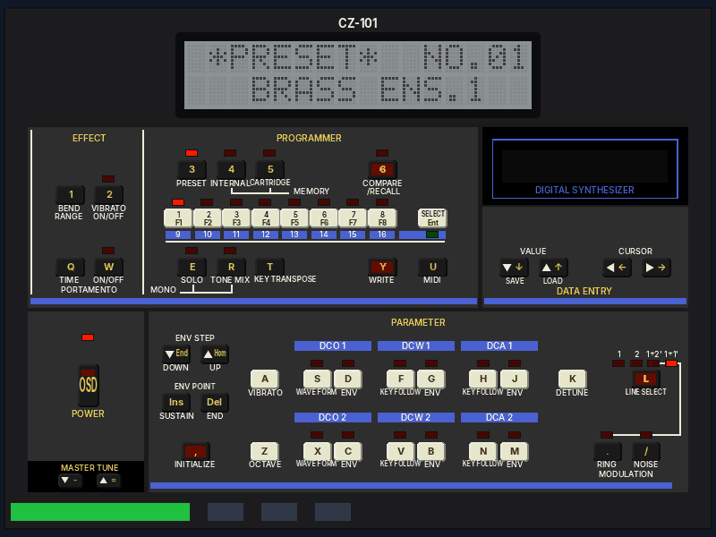

# Casio CZ-101 for MiSTer

An FPGA core of the Casio CZ-101 phase-distortion synthesizer (1984). It runs the original
firmware on a uPD7811 with the uPD933 sound chip, the HD44780 LCD and the battery-backed RAM.
Every part is written from MAME's `cz101` driver (BSD-3-Clause) and checked against a patched
MAME in lockstep, instruction for instruction and sample for sample. No ROMs are included.

The MiSTer screen: the front panel from MAME's `cz101.lay` with the LCD above it. LEDs are lit by the firmware, buttons show pressed while their key is held; each cap shows its keyboard key.

## Status

| Part | Check | Result |
|---|---|---|
| uPD7811 instruction set | 120 random programs against MAME's trace | 3 M instructions identical |
| uPD7811 peripherals | 160 random programs (timers, serial, interrupts, HLT) | identical, 309,527 interrupt entries |
| uPD933 | standalone copy of MAME's model on synthetic stimuli | identical |
| Board | `tests/c4_run.sh tests/midi/basic.txt 6500000`: real firmware, boot and MIDI playback | 6.5 M instructions (17.9 s) and 716,728 samples identical to MAME, SHA-256 08745dc2…0eb7; the same through the MiSTer's live-MIDI path |
| Panel keys, pitch wheel, MIDI out | `tests/c4_run.sh tests/midi/basic.txt 6500000 tests/panel/basic.txt`: the same, plus tone selection and pitch-wheel moves at the same CPU cycles in MAME and the HDL | trace and 717,228 samples identical, SHA-256 472320fd…08a9; the 63 MIDI-out bytes (program changes, the wheel's pitch bends) identical, each within 19 CPU cycles of MAME's |
| Battery RAM across a reload | `tests/reload_run.sh`: write preset 3 into internal tone 2 (`tests/panel/write.txt`), restart from that RAM, select internal tone 2 | the tone is kept; the firmware's tone buffers (0300-03FF) equal those with preset 3 selected |
| Pitch wheel | `tests/c4_run.sh tests/midi/basic.txt 6500000 tests/panel/wheel.txt`: five wheel moves during a held note | trace and 716,620 samples identical to MAME, SHA-256 4fd2c703…9035 (the sound-chip writes first differ from the plain run 4 ms after the first move) |
| Quartus (Windows build host) | `winbuild.sh cz101` | 14,577 ALMs (35 %), 37 DSP; timing met (core clock setup slack +4.13 ns at 50 MHz) |
| MiSTer | `scripts/mister/smoke.sh` | boots to PRESET NO.01; MIDI over the UART changes the patch; a panel key works; selecting a tone sends its program change out of the UART (read on `/dev/ttyS1` at 31,250 baud); no underrun; a tone written to internal memory (Write held, Internal, Tone 2) is in the 8 KB save file, survives a reload of the core and plays again when selected |

The plan, the timing rules and the open items are in [`docs/plan.md`](docs/plan.md); the CPU
notes and the MAME flag bugs found on the way are in [`docs/upd7810.md`](docs/upd7810.md).

## Using the core

1. **Make the ROM pack** from MAME's `cz101` set (the program ROM, `init_ram.bin`) and MAME's
   HD44780 character ROM `hd44780_a00.bin`:
   `python3 cores/cz101/tools/mkpack.py CZ101_DIR hd44780_a00.bin cz101.rom`.
   It warns when a file's SHA-1 is not MAME's.
2. **Install:** copy `cz101.rom` to `games/CZ-101/` and the core (`CZ101_YYYYMMDD.rbf`) to
   `_Devices/`. Load the pack from the OSD ("Load ROM pack"). The core remembers it.
3. **MIDI:** set the UART to MidiLink and route MidiLink to the UART (not to FluidSynth). The
   CZ-101 receives on the channel set with its MIDI button. Program change n selects preset
   n + 1 (the test corpus's program change 14 shows PRESET NO.15). MIDI out (tone selection,
   the pitch wheel) leaves through the UART's TX at 31,250 baud (the smoke test reads it back
   on the MiSTer's `/dev/ttyS1`).
4. **Pitch wheel:** the first joystick's Y axis (up raises the pitch), or its up/down
   directions for full bend. The firmware bends its own voices and sends pitch bend on MIDI out.
5. **Output gain (OSD):** 0 to +18 dB, saturating. The output runs at 96 kHz: the chip's
   40 kHz samples go through a 960-tap polyphase filter (flat to 18 kHz, images at or below
   -92 dB), so the HDMI and analog outputs carry no 40 kHz images.

The status strip under the LCD (synthframe's, as on the SC-55 and JV-880) shows the core's
state (green running, amber loading, red no ROM pack), MIDI activity, and an audio underrun
indicator (dark red once an underrun was seen).

Panel keys (PS/2 or USB keyboard, MAME's map, plus F1-F8 and Enter for keyboards without a
keypad):

| Key | Button | Key | Button |
|---|---|---|---|
| 1 | Bend Range | A | Vibrato |
| 2 | Vibrato On/Off | S / X | DCO1 / DCO2 Wave Form |
| 3 | Preset | D / C | DCO1 / DCO2 Envelope |
| 4 | Internal | F / V | DCW1 / DCW2 Key Follow |
| 5 | Cartridge | G / B | DCW1 / DCW2 Envelope |
| 6 | Compare/Recall | H / N | DCA1 / DCA2 Key Follow |
| Q | Portamento Time | J / M | DCA1 / DCA2 Envelope |
| W | Portamento On/Off | Z | Octave |
| E | Solo | , | Initialize |
| R | Tone Mix | K | Detune |
| T | Key Transpose | L | Line Select |
| Y | Write | . | Ring Modulation |
| U | MIDI | / | Noise Modulation |
| F1-F8, keypad 1-8 | Tone 1-8 | - / = | Master Tune down / up |
| Enter, keypad 0 | Select | ↓ / ↑ | Value down (Save) / up (Load) |
| ← / → | Cursor | End / Home | Env. Step down / up |
| Insert | Env. Point Sustain | Delete | Env. Point End |

The 49 music keys and the pitch wheel are not mapped; play notes over MIDI.

OSD switches: **Power** (off asserts /NMI and the firmware powers down; on again resets the
board with the RAM kept), **RA-3 cartridge**, **Memory protect**, **Auto power off**.

**Battery RAM:** the core keeps the 4 KB battery RAM and the 2 KB RA-3 cartridge in
`saves/CZ-101/<pack>.sav` (8 KB: 0000-0FFF RAM, 1000-17FF cartridge).
- When the pack loads, the save file replaces the pack's `init_ram.bin` image.
- The core writes the file when the OSD opens ("Autosave on OSD open", on by default) and from
  "Save RAM". The sound keeps playing; if the firmware writes the RAM during the save, the file
  is written a second time with the CPU paused.

## Layout

| Path | Contents |
|---|---|
| `hdl/upd7810/` | uPD7810/7811 CPU, peripherals, decode ROM generated from MAME's tables |
| `hdl/upd933/` | uPD933 sound chip |
| `hdl/cz101_board.sv` | the main board: memory map, LCD, keys, LEDs, timer, MIDI serializer |
| `hdl/cz101_lcd.sv`, `cz101_lcd_video.sv`, `cz101_kbd.sv` | HD44780 pins (the controller is `modules/synthframe/hdl/panel/synthframe_hd44780.sv`), LCD and LED video, PS/2 keys |
| `mister/` | MiSTer top (`CZ101.sv`), Quartus project, `build.sh` |
| `mame/patches/` | the MAME logging patch for the reference (`tools/mame-cz101.sh` runs it) |
| `sim/`, `tests/` | Verilator benches and the C1-C4 lockstep tests |
| `tools/` | `mkpack.py`, test-ROM and log tools |

## Licence

MIT (`LICENSE`). The core is written from MAME's BSD-3-Clause sources; `NOTICE` keeps MAME's
notice, names the authors and lists the parts under other licences: `ref/` and `mame/patches/`
are BSD-3-Clause, and a built RBF includes the MiSTer framework (GPL-2.0).
