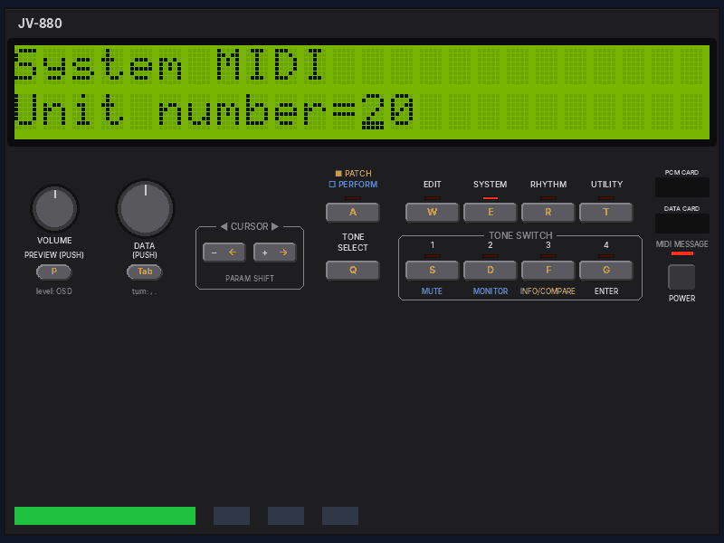

# Roland JV-880 for MiSTer

An FPGA core of the Roland JV-880 synthesizer module (1992). It runs the original firmware on an
H8/532 with the Roland PCM chip and the 2 × 24 character LCD. The CPU, peripherals and PCM chip
are the SC-55 core's (`modules/roland`) with the `jv880` model, checked sample for sample
against [Nuked-SC55](https://github.com/jcmoyer/Nuked-SC55) (`modules/nuked-sc55`, romsets
`jv880-v1.0.0` and `jv880-v1.0.1`). No ROMs are included.



The MiSTer screen in System mode: the front panel (owner's manual pp. 9-10) with the LCD; the SYSTEM and MIDI MESSAGE LEDs are lit by the firmware. Each button shows its keyboard key.

## Status

| Part | Check | Result |
|---|---|---|
| MCU (memory map, gate array, panel, encoder, NVRAM, timers) | `mcu_lockstep --romset jv880-v1.0.1 --jv880-factory`: from an empty NVRAM through the factory preset | 21,324,800 steps identical; the NVRAM's SHA-256 is d5da7845…d207, the reference's documented factory preset |
| PCM (wave ROM banks, 25/29 clock, filter) | `system_lockstep --smf jv880.mid` from the factory NVRAM | SHA-256 73feda3c…bbbc, the reference's integration-test hash |
| Board (pack, DDR3, pacing, MIDI, LCD) | `sim/jv880_board_bench --smf jv880.mid` from power-on, wave ROM through a DDR3 model | 42,181,775 steps and 1,640,121 samples identical to the reference; SHA-256 73feda3c…bbbc; 18.1 clocks a step of 30 |
| MIDI out | `mcu_lockstep --nvram factory --midi-at` with the system-area RQ1; `jv880_board_bench` decoding `uart_txd`; the MiSTer smoke | a 75-byte DT1, identical to the model's in byte and cycle, on `uart_txd`, and on the MiSTer's `/dev/ttyS1` |
| Quartus (Windows build host) | `winbuild.sh jv880`, seed 4 | 28,980 ALMs (69 %); timing met (core setup slack +0.948 ns) |
| MiSTer | `scripts/mister/smoke.sh` with the factory-preset pack | boots to "I-01:Syn Lead"; 60 s of `jv880.mid` over MidiLink and the autosave on OSD open with no underrun or lag; panel keys and the encoder respond as the reference's |

The plan and the reference's differences from the SC-55 are in [`docs/plan.md`](docs/plan.md).

## Using the core

1. **Make the ROM pack from your own JV-880 ROM dumps.** Use `jv880_rom1.bin`, a
   `jv880_rom2` (v1.0.0 or v1.0.1) and `jv880_waverom1/2.bin`; the files are recognised by
   SHA-256, whatever their names:
   `python3 cores/sc55/tools/romset.py pack DIR jv880.rom --romset jv880-v1.0.1`.
    - Optionally add `--nvram factory.nvram` to start from the factory preset.
    - `cores/sc55/ref/jv880_nvram.cpp` (built with the SC-55 simulators as `jv880-nvram`)
      makes that file: `jv880-nvram DIR factory.nvram`.
    - Without it, the unit starts as one whose battery ran down ("Internal RAM read error"). Then
      press UTILITY, turn to "Util:Factory preset" and press ENTER twice.
2. **Install:** copy `jv880.rom` to `games/JV-880/` and the core (`JV880_YYYYMMDD.rbf`) to
   `_Devices/`. Load the pack once from the OSD ("Load ROM pack"). The core remembers it and
   loads it again each time it starts.
    - A pack named `boot.rom` also loads by itself, but Main_MiSTer mounts no save file for it,
      so its NVRAM edits are not kept. Don't keep a `boot.rom` next to a pack you load from
      the OSD.
3. **MIDI:** set the UART to MidiLink and send MIDI.
    - In Patch mode the unit receives on channel 1 (`RxCH`). In Perf mode each part has its
      own channel.
    - MIDI that arrives while the firmware's receiver is still off (the first ~4 s of boot) is
      dropped, as on the real unit. The reference keeps those bytes, and a controller's MIDI
      clock during boot then leaves the firmware deaf to notes.
    - **MIDI out** goes back through the UART (MidiLink), at the speed MIDI comes in at. Data
      requests (RQ1) are answered. For example, the system area at device ID 17 gives a 75-byte
      DT1, identical to the reference's. The LCD shows "Now bulk sending" for about 1 s, then
      returns to the play screen. This needs a fix to the reference's serial transmitter
      (`cores/sc55/ref/patch_ref.py` FIXES): without it the firmware stayed in its sending state
      and the panel took no keys until the core was reloaded (`MIDI-OUT-PLAN.md`).
    - OSD **Diagnostics** shows a hex line under the status strip: MIDI bytes received, the
      last 4 bytes, the PCM's peak, the output's peak, and the underrun count.
4. **Output gain (OSD):** at 0 dB the PCM chip's 20-bit full scale is the 16-bit output's full
   scale, so the 16-bit conversion never clamps. +6 dB is the reference renderer's level (`>> 15`), which
   clamps the top 6 dB: 48 of the 64 factory patches reach it with one note or a 4-note chord at
   velocity 127 (I-22 SAW Lead with one note).

Panel keys (PS/2 or USB keyboard, the reference frontend's map):

| Key | Button |
|---|---|
| Q | TONE SELECT |
| W | EDIT |
| E | SYSTEM |
| R | RHYTHM |
| T | UTILITY |
| P | PREVIEW |
| A | PATCH/PERFORM |
| S | MUTE |
| D | MONITOR |
| F | COMPARE |
| G | ENTER |
| Tab | DATA (pushing the DATA dial: hold it while turning for large steps) |
| ← → | CURSOR |
| , . or ↓ ↑ | turning the DATA dial |

As on the unit, pressing a mode button (UTILITY, SYSTEM, RHYTHM, EDIT) again returns to play
mode; PATCH/PERFORM switches between patch and performance play.

The screen shows the front panel (`cfg/panel.yaml`) around the LCD: buttons show pressed while
their keys are held, and the indicators (PATCH, EDIT, SYSTEM, RHYTHM, UTILITY, TONE SWITCH 1-4,
MIDI MESSAGE) light as the firmware drives them.

**NVRAM (the unit's battery-backed memory):** the core keeps it in `saves/JV-880/<pack>.sav`
(32 KB, the reference's NVRAM layout).
- When the pack loads, the save file replaces the pack's NVRAM image. Before the first save,
  the unit starts from the pack's NVRAM image, or from an empty NVRAM.
- The core writes the file:
    - when the OSD opens ("Autosave on OSD open", on by default);
    - from "Save NVRAM".
- The sound keeps playing while the file is written. Only if the unit writes its NVRAM during
  the save (an edit at that moment) is the file written again with the sound paused for a moment.
- A reset keeps the NVRAM.

## Building and testing

```bash
cmake -S sim -B out/sim -G Ninja -DCMAKE_BUILD_TYPE=Release && ninja -C out/sim
out/sim/jv880_board_bench --roms DIR --pack jv880.rom [--smf jv880.mid --out out.raw] [--sav F --save-at N]
SYNTHROOT=$PWD/../.. ../../scripts/build-hosts/winbuild.sh jv880   # Quartus 17.0 on the Windows build host
```

The MCU and system benches are the SC-55's (`cores/sc55/sim`, `--romset jv880-v1.0.1`).

## Licence

GPL-2.0-or-later, as the SC-55 core and Nuked-SC55. `mister/sys/` is Template_MiSTer (GPL-2.0).
