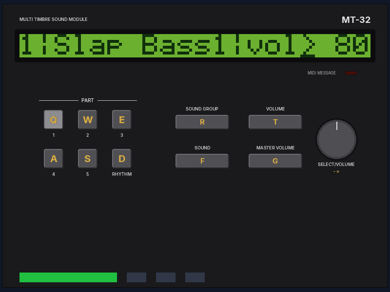

# Roland MT-32 for MiSTer

An FPGA core of the second-generation Roland MT-32 LA synthesis module. It runs the original
control ROM (firmware 2.0x) on an Intel 8098 (MCS-96), with the LA32 sound chip, the BOSS reverb
chip and the 20-character LCD. Every part is checked against
[Nuked-MT32](https://github.com/nukeykt/Nuked-MT32) (`modules/nuked-mt32`, commit `5b4e239`) in
lockstep: instruction for instruction, register write for register write and sample for sample.
No ROMs are included.

The MiSTer screen with Q held (Part 1 shows pressed): the front panel (owner's manual p. 2) with the LCD and the MIDI MESSAGE LED. Each button shows its keyboard key.

## Status

| Part | Check | Result |
|---|---|---|
| Reference (M0) | `ref/build.sh`, `tools/corpus.py`: headless Nuked-MT32 with log hooks, eight cases (76.8 s; `panel` presses buttons and turns the knob) | hashes in `tests/corpus.json`, the same on every run and from a build without the hooks (`tests/ref_hooks_check.sh`) |
| 8098 instruction set (M1) | `tools/c1_run.sh`: random programs over every opcode form, trace against the reference CPU | 60+ seeds identical (plain and with SFRs and interrupts); `tests/test_cpu.py` runs in CI without ROMs |
| 8098 peripherals (M2) | co-simulation: the HDL CPU inside Nuked-MT32's board, LA32 and reverb (`sim/cpu/`) | boot trace and all eight corpus hashes identical |
| LA32, reverb chip, mix (M3, M4) | replay of the reference's logs (`sim/sound/`, `tests/sound_check.sh`) | all eight cases identical, every output field, interrupt and slot state; design note `docs/sound.md` |
| System (M5) | `sim/system/`: the whole HDL from power-on, PCM ROM behind a random-latency memory model | all eight corpus hashes identical; CPU trace identical; identical to the reference across 2^48 / 375 LA32 cycles (25.45 h) and 2^48 CPU cycles (271 days), where 48-bit time used to wrap (`tests/wrap_check.sh`) |
| MiSTer (M6) | Windows build; `scripts/mister/smoke.sh` | 96 MHz: +0.263 ns (Windows), +0.570 ns (CI container); boots; MIDI and the Part 1 key change the LCD as in Nuked-MT32; no underrun on the dense corpus case or a game soundtrack; audio checked by ear (2026-11-24) |
| MIDI out | reference hook on `sbuf_w` (`T` trace lines), the HDL's SBUF-write tap in `sim/system/` and `sim/cpu/`; corpus case `rq1`; `scripts/mister/smoke.sh` reads the UART | `rq1`: 59 bytes (two DT1 replies), trace identical cycle for cycle; on the MiSTer the same bytes at 31,250 and at 9600 baud |

| Board and LCD | ROM-free 8098 programs on Nuked-MT32 and on the whole HDL (`tests/test_board.py`, `tests/test_lcd.py`) | bus decode traces identical; LCD state after every command and the dots `mt32_lcd_video` draws identical to `lcd.cpp` |

Tests: `tests/ci.sh` runs the ROM-free checks (`test_cpu.py`, `test_board.py`, `test_lcd.py`) and
is what CI runs. `tests/rom_gates.sh` runs the gates that need the ROMs (`MT32_ROM_DIR`): corpus
hashes from the reference, the co-simulation and the HDL system, the sound replay, the uptime
wrap and the unhooked reference. They are local only; without ROMs each prints `SKIP` and exits 77.

The plan, the hardware map and the timing rules are in [`docs/plan.md`](docs/plan.md).

## Using the core

1. **Make the ROM pack** from the second-generation MT-32 ROMs (control ROM 2.04 or 2.07, 128 KB;
   PCM ROM R15449121, 512 KB; reverb ROM R15179857, 32 KB):
   `python3 cores/mt32/tools/mkpack.py CONTROL REVERB PCM MT-32.rom`
   (or `--dir DIR OUT` with Nuked-MT32's file names). It warns when a file is not MAME's.
2. Copy the pack to `games/MT-32/` and load it once from the OSD (`Load ROM pack`; remembered).
3. Set the UART to MidiLink. Parts 1-8 listen on MIDI channels 2-9, rhythm on 10. MIDI out
   carries what the firmware sends, such as DT1 replies to RQ1 data requests.
4. Panel: Q W E R T = Part 1, 2, 3, Sound group, Volume; A S D F G = Part 4, 5, Rhythm, Sound,
   Master volume; - and = turn the volume knob.

## Licence

GPL-2.0-or-later, as Nuked-MT32; the 8098 HDL in `hdl/mcs96/` is MIT (from MAME's BSD-3-Clause
mcs96). See `NOTICE`.
