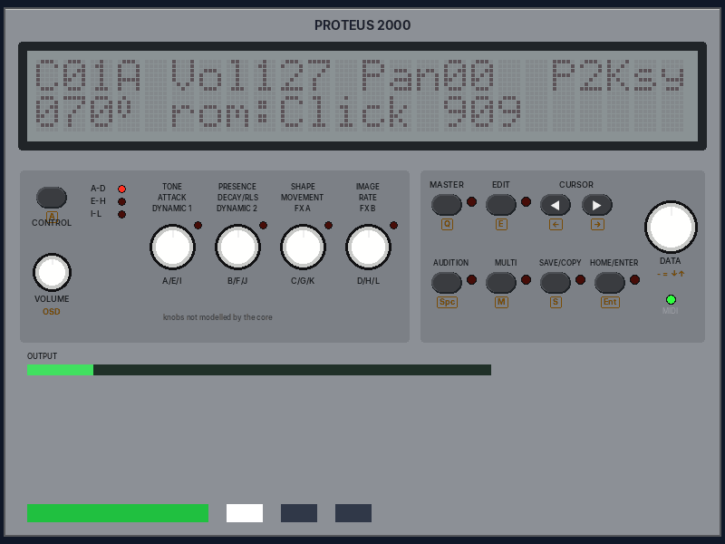

# E-mu Proteus 2000 for MiSTer

The Proteus 2000 running its own OS (2.26) on an FPGA model of the unit:

- **CPU:** a ColdFire MCF5206e. This is TG68K with the ColdFire changes and the MCF5206e
  peripherals, checked against MAME from reset to the main screen.
- **Sound engine:** the G20 voices, the H filters and interpolators and the G05 effects, bit-exact
  against the integer sound model the MAME driver uses (`cores/proteus/docs/p2k-mame-plan.md`).
- **Board:** the boot/OS flash and 8 MB of DRAM. Plan and design: `docs/plan.md`. Sources:
  `hdl/` (board, MiSTer parts) and `cores/proteus/p2k/rtl` (CPU, sound engine).

No SDRAM board is needed: the flash, DRAM, SIMMs and effect delay lines are in DDR3.



The MiSTer screen while MIDI plays: the front panel (owner's manual p. 21) with the LCD, the firmware's LEDs (control row A-D, MIDI) and the output level meter. Each button shows its keyboard key.

## Files you make

Nothing from the unit is in this repository. `tools/p2k_pack.py` builds the two files the core
loads from your own copies.

**System pack (`.p2k`)** is the flash image followed by the HD44780 character ROM:

```sh
tools/p2k_pack.py pack games/P2K/p2k.p2k --font hd44780_a00.bin \
    --dump proteus-2k-v124-28f160.bin --dli p2k226.dli
```

- The image is the v1.24 flash dump with OS 2.26 placed in it, built as MAME's `proteus2k`
  machine builds it.
- The user area is erased. On its first start the OS writes its factory defaults (about a minute).
  Open and close the OSD once so they go to the save file.
- `--flash` takes a finished 2 MB image instead.

**SIMM (`.sim`)** is a sound SIMM's Baby and Big images:

```sh
tools/p2k_pack.py simm games/P2K/composer.sim --baby baby.bin --big big.bin
```

No P2K SIMM dump is public. Two stand-ins can be built:
- `cores/proteus/tools/p2k_build_composer.py`: the Composer bank (ROM ID 4) with its 1024
  factory presets and 1173 instruments in E-mu's numbering, rebuilt from the factory preset
  SysEx, the manual's instrument list and a SoundFont conversion of the samples
  (`cores/proteus/docs/p2k-composer.md`). The factory user bank refers to these instruments too.
- `cores/proteus/tools/p2k_build_simm.py`: a SIMM from your own WAVs, with our own presets.

Load the pack, then a SIMM, from the OSD; an MGL can do both:

```xml
<mistergamedescription>
  <rbf>_Devices/P2K</rbf>
  <file delay="1" type="f" index="1" path="p2k.p2k"/>
  <file delay="2" type="f" index="2" path="composer.sim"/>
</mistergamedescription>
```

The CPU restarts after each download. `saves/P2K/<pack>.sav` holds the flash (user presets,
multisetups, master settings). It is written when the OSD opens after the OS has changed the
flash, or with "Save flash".

**User flash SIMMs:** mount a `.sim` file as "Flash SIMM slot 1" or "2" (OSD, or
`<file type="s" index="1" path="..."/>` in an MGL) instead of loading it into that slot. The OS
can then write it, as a real E-mu flash SIMM: from Save/Copy, COPY USER BANK TO FLASH, RENAME
FLASH SIMM, DUPLICATE SLOT 0 FLASH (it writes only a SIMM whose ROM ID is 106-119, the user flash
range). What it changed is written back to the mounted file with the flash save ("Save flash",
or when the OSD opens). Make the file 34 MB so every change fits:
`tools/p2k_pack.py simm OUT.sim --baby baby.bin --big big.bin --flash`, or `--blank` for an
erased one. Mounting reads the whole file through the SD interface; it takes longer than a
SIMM download (see `docs/plan.md`).

## Using it

- **MIDI:** set the UART to MidiLink; it is MIDI In A, at 31250 or 9600 baud. UART TX is MIDI Out
  (checked on the MiSTer with `scripts/mister/midi_probe.py`: the OS answers an identity request).
- **Panel keys:**

  | Key | Panel | Key | Panel |
  |---|---|---|---|
  | Q | Master | E | Edit |
  | M | Multi | S | Save/Copy |
  | A | Control | Space | Audition |
  | Enter | Home/Enter | ← → | cursor |
  | − = or ↓ ↑ | data entry knob | | |

  Control and Audition are confirmed by the LEDs they light (`cores/proteus/docs/p2k-findings.md`).
- **OSD:** master volume (the volume knob), filter and effects on/off (for comparison), save flash,
  autosave, reset.
- **Diagnostics** (OSD): a hex line under the screen with the CPU's PC, its last bus address and
  the load/hold flags.
- **Screen:** the front panel (`cfg/panel.yaml`) with the 2 × 24 LCD, its LEDs lit and its
  buttons shown pressed, an output level meter, and the status strip
  (green while running; the underrun box marks a sample the engine started late).

## Limits

- **No real unit was available.** Behaviour MAME could not settle is a recorded choice
  (`cores/proteus/docs/p2k-findings.md`): the level law, the interpolator timing, the effects'
  microcode.
- **Flash SIMMs** are written at once: the OS's erase and program polls see "ready" on the
  first read, where real flash takes seconds. A file mounted read-only is loaded and never
  written.
- **Not modelled:** MIDI In B, the Proteus 1000 and the sub outputs. Main + Sub 1 + Sub 2 are mixed
  to the one stereo output.
- **CPU speed:** the CPU runs at 44.1 MHz as fast as its cache allows; it is not cycle-matched to
  the MCF5206e. In simulation the OS reaches its main screen within a second of MAME (12.25 s
  against 11.5 s).
- **Start time on the MiSTer:** about 19 s from loading the MGL to the main screen with a 34 MB
  SIMM. Main_MiSTer writes the pack and SIMMs straight into DDR3 (load address 0x3C000000) and
  the core copies them into place; the OS start takes most of the rest.
