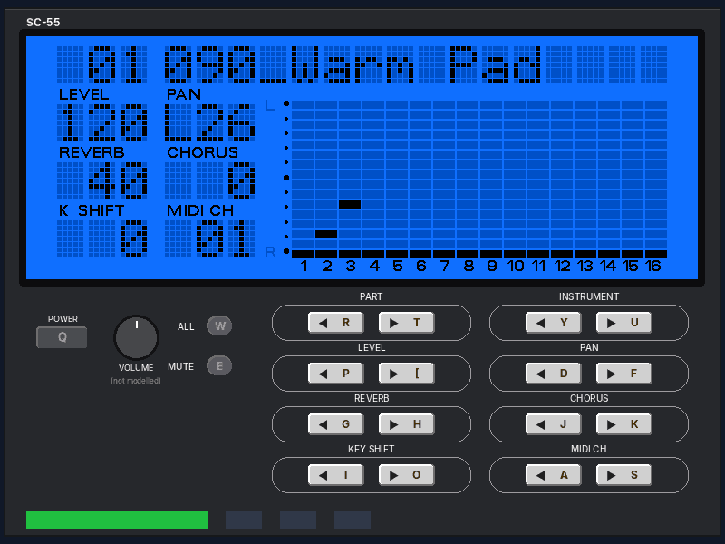

# SC-55 for MiSTer

A MiSTer FPGA core of the Roland SC-55 Sound Canvas (mk1), the SC-55mk2,
and the SC-155 / SC-155mk2, checked sample for sample against the
[Nuked-SC55](https://github.com/nukeykt/Nuked-SC55) emulator
([jcmoyer's fork](https://github.com/jcmoyer/Nuked-SC55) as the reference
model, `third_party/nuked-sc55`). No ROMs are included: you make a ROM pack
from your own dumps.



The MiSTer screen: the SC-55's LCD with its printed legends, and the front-panel buttons with their keyboard keys (pressed buttons light).

## Installing

You need two files on the MiSTer's SD card, the core and a ROM pack that you make from your own
ROM dumps:

```
SD card
├── _Devices/
│   └── SC55_YYYYMMDD.rbf     the core, from releases/
└── games/
    └── SC-55/
        └── boot.rom          the ROM pack you make in step 2
```

### 1. Get the ROM dumps

No ROMs are included. Pick one model and get every chip listed for it. The file names don't
matter: the pack tool recognises each file by its SHA-256 hash, so files already named for
Nuked-SC55 (`sc55_rom1.bin`, `waverom1.bin`, …) work as they are.

**SC-55 (mk1) v1.21** (tested), romset `mk1-v1.21`:

| Chip | Contents | Size |
|---|---|---|
| R15199778 | H8/532 MCU program (ROM1) | 32 KB |
| R15209363 | H8/532 extra code (ROM2) | 256 KB |
| R15209276 | Wave ROM A (WAVEROM1) | 1 MB |
| R15209277 | Wave ROM B (WAVEROM2) | 1 MB |
| R15209281 | Wave ROM C (WAVEROM3) | 1 MB |

Other mk1 firmware is packed the same way but has not been tested on the core. Use the same three
wave ROMs with this ROM1 and ROM2:

| Version | Romset | ROM1 | ROM2 |
|---|---|---|---|
| v1.00 | `mk1-v1.00` | R15199748 | R15449258 |
| v1.10 | `mk1-v1.10` | R15199736 | R15209275 |
| v1.20 | `mk1-v1.20` | R15199778 | R15209337 |
| v2.00 | `mk1-v2.00` | R15199799 | R15209387 |

**SC-55mk2 v1.01** (tested), romset `mk2-v1.01`:

| Chip | Contents | Size |
|---|---|---|
| R15199858 | H8/532 MCU program (ROM1) | 32 KB |
| R00233567 | H8/532 extra code (ROM2) | 512 KB |
| R15199880 | M37450 sub-MCU program (SMROM) | 4 KB |
| R15209359 | Wave ROM, 16 Mbit (WAVEROM1) | 2 MB |
| R15279813 | Wave ROM, 8 Mbit (WAVEROM2) | 1 MB |

**SC-155 rev1** (tested), romset `sc155-rev1`:

| Chip | Contents | Size |
|---|---|---|
| R15199799 | H8/532 MCU program (ROM1) | 32 KB |
| R15209361 | H8/532 extra code (ROM2) | 256 KB |
| R15209276 | Wave ROM A (WAVEROM1) | 1 MB |
| R15209277 | Wave ROM B (WAVEROM2) | 1 MB |
| R15209281 | Wave ROM C (WAVEROM3) | 1 MB |

**SC-155mk2 v1.01** (not tested), romset `sc155mk2-v1.01`: the same five files as the SC-55mk2.

The hashes are in Nuked-SC55's
[`doc/supported_romsets.rst`](https://github.com/jcmoyer/Nuked-SC55/blob/main/doc/supported_romsets.rst).
This core does not run that table's SC-55st, CM-300/SCC-1, SCB-55 or RLP-3237 sets. The JV-880 has
its own core.

### 2. Make the ROM pack

On a PC with git and Python 3.10 or newer (on Windows, type `py` for `python3`):

```bash
git clone --recursive https://github.com/gmcnaught/synthcores
cd synthcores/cores/sc55
python3 tools/romset.py check ~/sc55-dumps
python3 tools/romset.py pack ~/sc55-dumps boot.rom --romset mk2-v1.01
```

- `check` lists each file it recognised and which romsets are complete in that folder.
- `pack` writes `boot.rom` (4,755,712 bytes) for the romset you name; without `--romset` it
  packs `mk1-v1.21`. The pack's header tells the core which model to be.
- If a chip is missing, `pack` stops with an error that names it, e.g.
  `LookupError: mk2-v1.01: missing SMROM in /home/me/sc55-dumps`.

### 3. Copy the files to the SD card

1. Copy `boot.rom` to `games/SC-55/boot.rom` (make the `SC-55` folder if it is not there). The core
   loads it each time it starts.
2. Copy the newest `SC55_YYYYMMDD.rbf` from [`releases/`](releases/) to `_Devices/`. Any core
   folder works; the core shows up under that folder in the MiSTer menu.
3. Optional: to switch between models, put more packs next to it (e.g. `games/SC-55/mk1.rom`)
   and load one from the core's OSD with **Load ROM pack**.

### 4. Connect MIDI

The core plays the MIDI that arrives on the MiSTer's UART through MidiLink.

1. Plug a USB MIDI interface or a USB MIDI keyboard into the MiSTer.
2. Load the core, open the OSD (F12) and press Right to reach the **System** page.
3. Open **UART mode**, set **Connection** to **MIDI** and **MidiLink** to **USB**. Main_MiSTer
   saves this per core.
4. Send MIDI. The SC-55 is multitimbral: part 1 plays channel 1, …, part 10 (drums) plays
   channel 10. The bar graph on the screen shows which parts are playing.
5. MIDI out goes back through the same UART at the same speed:
    - every model sends Active Sensing (FE). Known issue: on the MiSTer the mk1 stops sending it
      after it receives a GS data request (RQ1); simulation does not show this ([#52](https://github.com/gmcnaught/synthcores/issues/52));
    - the mk2 answers GS data requests (RQ1) with DT1 (the SC-155mk2 is not checked);
    - the mk1's firmware answers no RQ1, in the reference as well.

Panel keys (PS/2 or USB keyboard): Q power, W all, E mute, R/T part, Y/U instrument, I/O key
shift, P/[ level, A/S MIDI channel, D/F pan, G/H reverb, J/K chorus, arrows part.

## Status (November 2026)

| Part | Status | Docs |
|---|---|---|
| H8/532 CPU | identical to the reference instruction by instruction (firmware, MIDI traffic, random code; 18/18 seeded faults caught) | [`docs/cpu.md`](docs/cpu.md) |
| MCU peripherals (timers, SCI, A/D, gate array, memory map; mk1 and mk2) | identical step by step | [`docs/mcu.md`](docs/mcu.md) |
| mk2 sub-MCU (M37450) | identical instruction by instruction (firmware, random code; 16/16 seeded faults) | [`docs/mk2.md`](docs/mk2.md) |
| PCM chip (voices, reverb/chorus; mk1 and mk2) | identical sample for sample | [`docs/pcm.md`](docs/pcm.md) |
| Whole core | avmidi `0A.mid` rendered by the HDL = the reference renderer (mk1) and jcmoyer's own integration hash (mk2) | [`docs/board.md`](docs/board.md), [`docs/mk2.md`](docs/mk2.md) |
| MiSTer board (ROM pack, DDR3 wave ROMs, pacing, MIDI, audio) | identical in simulation from power-on | [`docs/board.md`](docs/board.md) |
| LCD and panel keys | LCD identical pixel for pixel to the reference's renderer | [`docs/lcd.md`](docs/lcd.md) |
| MiSTer hardware | mk1 and mk2: play MIDI in real time (100 s of avmidi 0A.mid, no underrun or lag) | [`docs/board.md`](docs/board.md), [`docs/mk2.md`](docs/mk2.md) |
| MIDI out | the bytes the model sends identical in byte and cycle (`mcu_lockstep`: mk1 Active Sensing, mk2 GS RQ1 → DT1) and on `uart_txd` (`board_lockstep`); MiSTer: the mk2's DT1 on `/dev/ttyS1` = the model's; the mk1's Active Sensing stops after an RQ1 ([#52](https://github.com/gmcnaught/synthcores/issues/52)) | [`MIDI-OUT-PLAN.md`](../../MIDI-OUT-PLAN.md) |

## Building and testing

```bash
cmake -S sim -B out/sim -G Ninja -DCMAKE_BUILD_TYPE=Release && ninja -C out/sim
for t in tests/test_*.py; do python3 $t; done      # ROM tests need firmware/ (or SC55_ROM_DIR)
mister/build.sh                                    # Quartus Lite 17.0; or the "Build RBF" workflow
```

The ROM tests read your dumps from `firmware/` (ignored by git) or from `SC55_ROM_DIR`.

## Licence

GPL-2.0-or-later, as Nuked-SC55 ([`LICENSE`](LICENSE)). `mister/sys/` is
Template_MiSTer (GPL-2.0). Some board modules come from the author's
synclavierii project (MIT).
