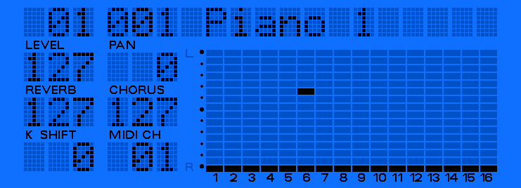

# LCD and front panel (M6)

| Part | File | What it does |
|---|---|---|
| LCD controller | `hdl/board/lcd_ctrl.sv` | `LCD_Write` (lcd.cpp): commands at F105 and data at F104 from the MCU; display data (80 bytes), CG RAM (64 × 5 bits), address counters, modes; `LCD_Enable` from the MCU's `io_sd` |
| Renderer | `hdl/board/lcd_video.sv` | 800 × 600 at 60 Hz (40 MHz pixel clock from the PLL). The LCD drawn 1:1 as `LCD_Render` draws it for the mk1 (741 × 268 at (29, 40)): the background bitmap, the eight text fields (5 × 7 dots of 5 × 5 pixels on a 6-pixel pitch), the L/R marks and the 16 level bars; a status strip under it (red no ROM pack, amber loading, green running; MIDI and underrun boxes). Four pipeline stages. |
| Tables | `tools/gen_lcd_tables.py` → `lcd_font.svh`, `lcd_back.hex` | generated from the reference's `lcd_font.h` and `lcd_back.h` (8 background pixels per byte) |
| Panel keys | `hdl/board/kbd_buttons.sv` | the reference frontend's key map: Q power, W all, E mute, R/T part, Y/U instrument, I/O key shift, P/[ level, A/S MIDI channel, D/F pan, G/H reverb, J/K chorus, arrows part |

## Verification (`sim/board/board_lockstep.cpp`)

The model keeps LCD state only with an LCD backend, so the bench attaches
an empty one. Every step the HDL controller's display data, CG RAM and
address counter must equal the model's; at the end one HDL video frame is
compared pixel for pixel with the model's `LCD_Render` buffer.

| Run | Result |
|---|---|
| board, loud MIDI, 8 M steps | controller identical every step; frame identical (198,588 pixels): `01 001 Piano 1`, level bars |
